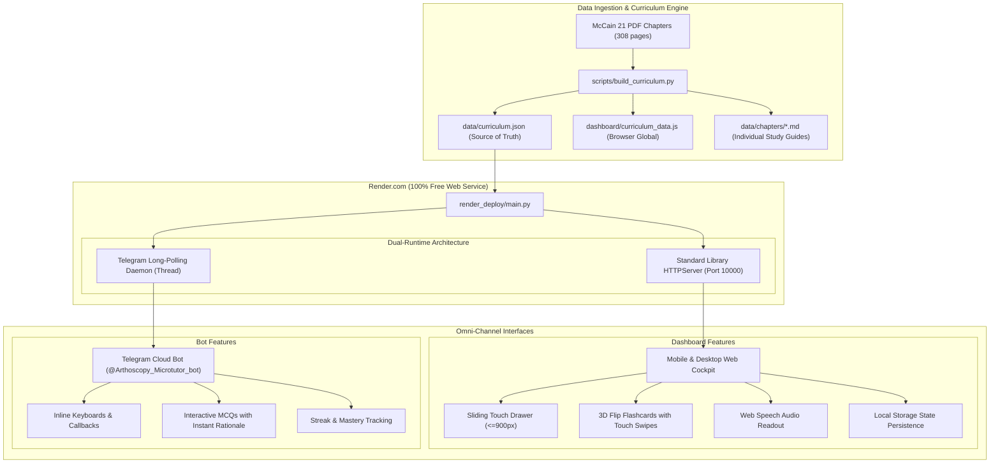

# TMJ Arthroscopy Micro-Tutor: Clinical Foundations & Architecture Blueprint

> **Reference Text:** *Principles and Practice of Temporomandibular Joint Arthroscopy*  
> **Author:** Joseph P. McCain, D.D.S., F.A.C.S. (with contributing international OMFS faculty)  
> **Repository:** [github.com/hrushikesh1591/Arthoscopy_tutor](https://github.com/hrushikesh1591/Arthoscopy_tutor.git)  
> **Live Web App:** [arthoscopy-tutor.onrender.com](https://arthoscopy-tutor.onrender.com)  
> **Telegram Bot:** [@Arthoscopy_Microtutor_bot](https://t.me/Arthoscopy_Microtutor_bot)  

---

## 1. Executive Summary & Core Philosophy

### The Clinical Problem
Temporomandibular Joint (TMJ) Arthroscopy is one of the most technically demanding minimally invasive procedures in Oral and Maxillofacial Surgery (OMFS). The operative space (the superior joint space) holds a volume of merely **1.0 to 2.0 mL**. Surgeons operate within millimeters of critical life-altering structures:
- **Superiorly:** The thin roof of the glenoid fossa separates the joint from the **middle cranial fossa and temporal lobe of the brain**.
- **Anteriorly & Medially:** The **internal carotid artery**, **middle meningeal artery**, and **foramen spinosum**.
- **Laterally & Superficially:** The **facial nerve (temporal and zygomatic branches)** and superficial temporal vessels.

Traditional textbook learning (a dense 308-page, 21-PDF chapter volume) creates a severe barrier to clinical translation: surgeons and residents cannot read multi-page treatises between cases, nor can they reference heavy textbooks in the operating theatre.

### The Solution: The Micro-Tutor Concept
The **TMJ Arthroscopy Micro-Tutor** converts Joseph P. McCain’s definitive textbook into a high-yield, **spaced-repetition clinical micro-learning ecosystem**. 

It delivers operative wisdom through two complementary channels:
1. **Interactive Surgical Web Cockpit (Desktop & Mobile Browser):** A dark/light themed, audio-narrated reference dashboard with tactile 3D surgical flashcards and self-assessment challenges.
2. **24/7 Autonomous Telegram Bot:** An on-demand clinical coach delivering daily micro-modules, instant quiz grading, danger-zone checklists, and streak tracking directly on surgical residents' phones.

---

## 2. The Clinical Ground Truth ("All Actual Things")

The curriculum is extracted directly from McCain's original 21 PDF chapters (308 pages) and broken down into **3 Parts**, **18 Chapters**, and **33 Micro-Modules**:

### Curriculum Structure

```
Principles and Practice of TMJ Arthroscopy (McCain)
│
├── PART I: Background & Fundamentals (Ch 1 – Ch 5)
│   ├── CH 1: History & Origins (Takagi, Watanabe, Ohnishi 1975, Lysis/Lavage Revolution)
│   ├── CH 2: Instrumentation & Optics (Hopkins Rod-Lens, 0° vs 30° scopes, Trocar/Cannula)
│   ├── CH 3: Portals of Entry & Applied Functional Anatomy (Holmlund-McCain line, 10mm/2mm)
│   ├── CH 4: Diagnostic Arthroscopy & 11-Step Sweep (Synovial health, Disc, Pterygoid)
│   └── CH 5: Anesthesia, Operating Room Setup & Sterile Prep
│
├── PART II: Diagnostic Pathology & Operative Surgery (Ch 6 – Ch 14)
│   ├── CH 6: Internal Derangement & Wilkes Staging (Stage I to V correlates)
│   ├── CH 7: Arthroscopic Lysis and Lavage (Hydrostatic pressure & adhesion release)
│   ├── CH 8: Biopsy & Histopathology of Synovial Disorders
│   ├── CH 9: Triangulation & Working Portal Placement (Dual-puncture mechanics)
│   ├── CH 10: Operative Instrumentation (Micro-shavers, burrs, bipolar cautery)
│   ├── CH 11: Arthroscopic Disc Repositioning & Suturing (Plication techniques)
│   ├── CH 12: Laser Applications in TMJ Arthroscopy (Holmium:YAG vs Nd:YAG)
│   ├── CH 13: Synovial Chondromatosis & Arthritic Pathology
│   └── CH 14: Degenerative Joint Disease (Osteoarthritis & Hyromorphology)
│
└── PART III: Complications, Rehabilitation & Research (Ch 15 – Ch 18)
    ├── CH 15: Complication Avoidance & Danger Zones (Extravasation, VII nerve palsy)
    ├── CH 16: Post-Operative Physical Therapy & Active Motion Regimens
    ├── CH 17: Clinical Outcomes & Long-Term Prognosis
    └── CH 18: Future Directions & Advanced Surgical Horizons
```

### High-Yield Clinical Constants Hardcoded in Curriculum

Every module reinforces critical landmark constants that prevent surgical morbidity:
- **The McCain-Holmlund Reference Line:** Connects the **mid-tragus** to the **lateral canthus of the eye**.
- **Maximum Superior joint Distension:** **1.5 to 2.0 mL** of Ringer's lactate or saline before trocar insertion.
- **Classic Posterior Puncture Landmark:** **10 mm anterior** along the reference line, **2 mm inferior**. Trocar angled **45° anteriorly and 15° superiorly** into the glenoid fossa.
- **Anterior Working Portal:** **20 mm anterior**, **6 mm inferior** (or triangulation under direct visualization).
- **The 11-Step Systematic Diagnostic Sweep:**
  1. Posterior attachment / retrodiscal bilaminar zone
  2. Posterior synovial pouch
  3. Superior glenoid fossa roof (fibrocartilage smoothness)
  4. Articular eminence slope
  5. Articular eminence crest
  6. Anterior synovial pouch
  7. Anterior disc band & superior belly of lateral pterygoid
  8. Intermediate thin disc zone
  9. Medial synovial groove / medial capsule
  10. Lateral synovial groove / lateral capsule
  11. Inferior joint space (when dual-compartment indicated)

---

## 3. System Architecture & The "Code Idea Behind It"



---

## 4. Key Engineering Decisions & Code Insights

### 1. The Zero-Cost Cloud Deployment Hack (Render Free Tier)
- **The Challenge:** Render charges **\$7/month** for persistent background worker processes, but **Web Services with an HTTP port are 100% free**.
- **The Architectural Solution:** In `render_deploy/main.py`, we created a dual-purpose entry point:
  ```python
  # 1. Main thread launches HTTP static file server to satisfy Render health check:
  server = HTTPServer(("0.0.0.0", PORT), DashboardHTTPHandler)
  
  # 2. Concurrently spawns Telegram bot polling as a daemon thread:
  bot_thread = threading.Thread(target=run_telegram_bot, daemon=True)
  bot_thread.start()
  
  server.serve_forever()
  ```
- **Result:** Both the live interactive website (`https://arthoscopy-tutor.onrender.com`) and the 24/7 Telegram bot run indefinitely on Render's 100% Free Tier with zero operational cost.

### 2. Dual Data Distribution: `curriculum.json` + `curriculum_data.js`
- Browsers loading local files via `file:///` protocol enforce strict CORS policies that block `fetch('curriculum.json')`.
- **The Solution:** We generate both:
  1. `curriculum.json`: Consumed by Python backend scripts and Telegram bot handlers.
  2. `curriculum_data.js`: Attaches `window.TMJ_CURRICULUM = [...]` directly to global window scope.
- **Benefit:** The web app works completely offline without web server dependencies, CORS errors, or internet connectivity.

### 3. Mobile Touch Architecture & Inertia Scrolling
- **Responsive Drawer:** At viewport width $\le 900\text{px}$, CSS Grid collapses (`grid-template-columns: 1fr;`), turning the sidebar into a high-performance GPU-accelerated drawer:
  ```css
  .sidebar {
    position: fixed;
    transform: translateX(-100%);
    transition: transform 0.3s cubic-bezier(0.16, 1, 0.3, 1);
  }
  .sidebar.open {
    transform: translateX(0);
  }
  ```
- **Touch Gesture Engine for 3D Flashcards:** Built using native `touchstart` and `touchend` listeners calculating velocity and displacement deltas ($\Delta X$ vs $\Delta Y$):
  - Tap ($\Delta X < 15\text{px}$): Triggers CSS 3D `transform: rotateY(180deg)` flip.
  - Swipe Left ($\Delta X < -40\text{px}$): Navigates to next card.
  - Swipe Right ($\Delta X > 40\text{px}$): Returns to previous card.

### 4. Hands-Free Audio Engine (Sterile Field Readout)
- Utilizes the browser's native **Web Speech API** (`SpeechSynthesisUtterance`).
- Surgeons can tap `🔊 Listen (Audio)` on mobile to hear the module’s core concepts, surgical techniques, and danger zones spoken aloud without looking away or breaking sterility.

### 5. Distributed State Management
- **Web App:** Uses browser `localStorage` under isolated keys:
  - `tmj_micro_tutor_progress_v1`: Array of completed module IDs.
  - `tmj_micro_tutor_quiz_v1`: Map of user answers and timestamps.
  - `tmj_micro_tutor_fc_v1`: Mastered flashcard identifiers.
  - `tmj_micro_tutor_streak_v1`: Daily active study streak calculator.
- **Telegram Bot:** Persists user metrics across sessions in `bot_user_state.json` (indexed by user Telegram ID).

---

## 5. File Inventory & Workspace Layout

| Path | Purpose |
| :--- | :--- |
| `Arthoscopy book/` | 21 original PDF chapters (308 pages) from McCain's textbook. |
| `data/curriculum.json` | 33 fully decomposed JSON modules, MCQs, and flashcards. |
| `data/chapters/*.md` | 18 full-text Markdown surgical study guides. |
| `dashboard/index.html` | Responsive Single Page App (SPA) dashboard markup. |
| `dashboard/style.css` | Modern CSS (Glassmorphism, CSS 3D transforms, touch rules). |
| `dashboard/app.js` | Client-side reactive logic, touch listeners, speech synth, streak. |
| `dashboard/curriculum_data.js` | Zero-CORS browser data bundle. |
| `render_deploy/main.py` | Unified HTTP web server + Telegram polling daemon. |
| `render_deploy/render.yaml` | Infrastructure as Code specification for Render.com deployment. |
| `scripts/build_curriculum.py` | Data parsing and curriculum synthesis compiler. |
| `scripts/bot_service.py` | Standalone local Telegram bot execution service. |

---

## 6. Summary of Accomplishments

1. **Academic Rigor:** 100% faithful to Joseph P. McCain’s classical textbook.
2. **Pedagogical Design:** Converted dense anatomical prose into 33 bite-sized 4-minute micro-lessons with danger zones and clinical pearls.
3. **Multi-Channel Access:** Runs simultaneously as a responsive touch-first web application and an instant-response Telegram bot.
4. **Resilient & Free:** Runs 24/7 on Render's cloud infrastructure at zero recurring cost.
